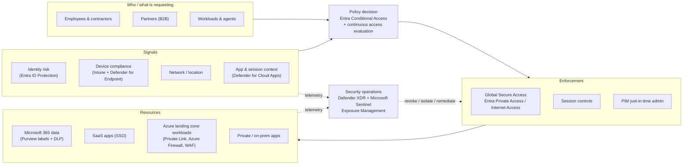

# Zero Trust Reference Architecture for a Mid-Size Organization on Azure and Microsoft 365

A docs-first security architecture for a **fictional** 2,500-person
organization moving from a VPN-and-perimeter model to Zero Trust on Microsoft
Entra, Microsoft 365, and Azure. It covers the target-state design for each
pillar, the architecture decisions behind it (ADRs), how it maps to the
Microsoft Cybersecurity Reference Architectures (MCRA) and the Microsoft
cloud security benchmark (MCSB), and a phased roadmap with risks,
dependencies, and owners.

> **What this is and isn't.** It's a design artifact written for SC-100
> (Cybersecurity Architect) preparation and as a portfolio work sample. The
> organization, its constraints, and its baseline are invented for the
> exercise. Nothing here describes a real employer or customer. No outcomes
> are claimed. Targets in the roadmap are **targets**, not measured results.
> The identity pillar has a companion implementation in Terraform:
> [azure-entra-identity-hardening](https://github.com/mikedsosa/azure-entra-identity-hardening)
> (validated with `terraform validate`, **not yet deployed**).

## Problem

The fictional organization ("Fabrikam") has:

- Hybrid identity (on-prem AD DS synced to Entra ID), MFA for some users,
  legacy authentication still allowed, and ~40 standing Global Administrators
- A flat site-to-site/VPN network where any VPN user can reach most
  internal servers
- Mixed device estate, partly managed, and no compliance gate on access
- Sensitive client data in SharePoint/OneDrive and Azure Storage with no
  classification
- Azure workloads built subscription-by-subscription with no landing zone,
  inconsistent logging, and no central SIEM
- A ransomware tabletop that showed backups and admin accounts sharing the
  same blast radius

Leadership wants a defensible, staged plan that reduces breach impact without
stopping the business, and evidence for auditors that controls exist.

## Approach

1. Start from Microsoft's three Zero Trust principles: **verify explicitly,
   use least privilege access, assume breach**
   ([docs/01-principles.md](docs/01-principles.md)).
2. Set scope, constraints, and assumptions up front
   ([docs/00-context.md](docs/00-context.md)).
3. Design each pillar (identity, endpoints, network, data, applications,
   infrastructure) plus security operations as the cross-cutting
   visibility/automation layer ([docs/pillars/](docs/pillars/)).
4. Record every significant choice as an ADR with options and trade-offs
   ([docs/adr/](docs/adr/)).
5. Trace the design to **MCRA** and to **MCSB control IDs**
   ([docs/03-mcra-mcsb-mapping.md](docs/03-mcra-mcsb-mapping.md)).
6. Sequence the work into a roadmap with dependencies, risks, RACI, and
   measures ([docs/04-roadmap.md](docs/04-roadmap.md)).

## Target architecture at a glance



## How to read this repo

| If you are... | Start with | Then |
|---|---|---|
| A hiring manager / leader (10 min) | This README | [Roadmap](docs/04-roadmap.md) (phases, risks, RACI) |
| A security architect | [Principles](docs/01-principles.md) → [pillars](docs/pillars/) | [ADRs](docs/adr/), [MCRA/MCSB mapping](docs/03-mcra-mcsb-mapping.md) |
| An engineer | [Identity pillar](docs/pillars/identity.md) | [Identity implementation](docs/05-identity-implementation.md) and the companion Terraform repo |
| A GRC / audit reader | [MCSB mapping](docs/03-mcra-mcsb-mapping.md) | ADRs for rationale, roadmap for timing |

```
.
├── README.md
├── docs/
│   ├── 00-context.md                 # fictional org, scope, constraints, assumptions
│   ├── 01-principles.md              # Zero Trust + design principles
│   ├── 02-architecture-overview.md   # logical architecture and diagrams
│   ├── pillars/
│   │   ├── identity.md
│   │   ├── endpoints.md
│   │   ├── network.md
│   │   ├── data.md
│   │   ├── applications.md
│   │   ├── infrastructure.md
│   │   └── security-operations.md
│   ├── 03-mcra-mcsb-mapping.md
│   ├── 04-roadmap.md                 # phases, dependencies, risks, RACI, measures
│   ├── 05-identity-implementation.md # link to the Terraform lab
│   └── adr/                          # architecture decision records
└── LICENSE
```

## SC-100 objective mapping

Mapped to the SC-100 skills outline published as of October 21, 2026
([study guide](https://learn.microsoft.com/credentials/certifications/resources/study-guides/sc-100)).

| SC-100 skill area | Objective (abridged) | Where it's covered |
|---|---|---|
| Design solutions that align with security best practices and priorities | Design solutions that align with MCRA and MCSB | [03-mcra-mcsb-mapping.md](docs/03-mcra-mcsb-mapping.md) |
| | Design solutions that align with the Zero Trust adoption framework | [01-principles.md](docs/01-principles.md), [04-roadmap.md](docs/04-roadmap.md) |
| | Design a resiliency strategy for ransomware, including BCDR and privileged access | [infrastructure.md](docs/pillars/infrastructure.md), [ADR-0003](docs/adr/0003-pim-just-in-time-admin.md), [ADR-0009](docs/adr/0009-immutable-backups-separate-admin-plane.md) |
| | Design solutions using CAF / Well-Architected and Azure landing zones | [infrastructure.md](docs/pillars/infrastructure.md), [ADR-0005](docs/adr/0005-azure-landing-zones-policy-as-guardrails.md) |
| | Design a DevSecOps process | [applications.md](docs/pillars/applications.md) |
| Design security operations, identity, and compliance capabilities | Detection and response with XDR and SIEM, SOAR, MITRE ATT&CK coverage | [security-operations.md](docs/pillars/security-operations.md), [ADR-0008](docs/adr/0008-defender-xdr-plus-sentinel.md) |
| | Modern authentication and authorization: Conditional Access, CAE, risk, protected actions | [identity.md](docs/pillars/identity.md), [ADR-0002](docs/adr/0002-phishing-resistant-mfa-for-admins.md) |
| | Validate alignment of Conditional Access with Zero Trust | [identity.md](docs/pillars/identity.md#conditional-access-policy-framework), [05-identity-implementation.md](docs/05-identity-implementation.md) |
| | External identities (B2B) and agent identities | [identity.md](docs/pillars/identity.md) |
| | Specify requirements to harden AD DS | [identity.md](docs/pillars/identity.md#hybrid-identity-and-ad-ds-hardening) |
| | Privileged access: enterprise access model, PIM, access reviews, secure workstations | [identity.md](docs/pillars/identity.md#privileged-access), [ADR-0003](docs/adr/0003-pim-just-in-time-admin.md) |
| | Regulatory compliance: Purview, Azure Policy, Defender for Cloud | [data.md](docs/pillars/data.md), [infrastructure.md](docs/pillars/infrastructure.md) |
| Design security solutions for infrastructure | Posture management with Defender for Cloud, Secure Score, Exposure Management | [infrastructure.md](docs/pillars/infrastructure.md), [security-operations.md](docs/pillars/security-operations.md) |
| | Server and client endpoint requirements, baselines, Windows LAPS | [endpoints.md](docs/pillars/endpoints.md) |
| | SaaS/PaaS/IaaS baselines, containers | [infrastructure.md](docs/pillars/infrastructure.md), [applications.md](docs/pillars/applications.md) |
| | Network security and SSE with Entra Private Access / Internet Access | [network.md](docs/pillars/network.md), [ADR-0004](docs/adr/0004-entra-private-access-replaces-vpn.md) |
| Design security solutions for applications and data | Microsoft 365: Defender for Office 365, Defender for Cloud Apps, Intune, Purview | [data.md](docs/pillars/data.md), [endpoints.md](docs/pillars/endpoints.md), [applications.md](docs/pillars/applications.md) |
| | Workload identities, API management, WAF | [applications.md](docs/pillars/applications.md) |
| | Data discovery, classification, encryption, Key Vault, data for AI workloads | [data.md](docs/pillars/data.md), [ADR-0006](docs/adr/0006-purview-sensitivity-labels-default.md) |

## Quality checks

| Check | How | Result |
|---|---|---|
| Mermaid diagrams render | `@mermaid-js/mermaid-cli` 11.17.0 on every diagram | 13/13 rendered without errors (2026-10-23) |
| Relative links resolve | Script check of every Markdown link | 0 broken links (2026-10-23) |
| Secret scan | `gitleaks dir` and `gitleaks git` 8.30.1 | No leaks found (2026-10-23) |
| MCSB/MCRA references | Checked by hand against Microsoft Learn | IDs verified 2026-10-23 |

This is a design document set. Nothing here has been deployed.

## Sources

- Microsoft Zero Trust guidance and adoption framework: <https://learn.microsoft.com/security/zero-trust/>
- Microsoft Cybersecurity Reference Architectures (April 2025 version): <https://learn.microsoft.com/security/adoption/mcra>
- Microsoft cloud security benchmark v2 (preview): <https://learn.microsoft.com/security/benchmark/azure/overview>
- Microsoft cloud security benchmark v1, Governance and Strategy (GS) domain: <https://learn.microsoft.com/security/benchmark/azure/mcsb-governance-strategy>
- SC-100 study guide: <https://learn.microsoft.com/credentials/certifications/resources/study-guides/sc-100>

Control IDs were checked against the pages above on 2026-10-23.

## License

MIT. See [LICENSE](LICENSE).
