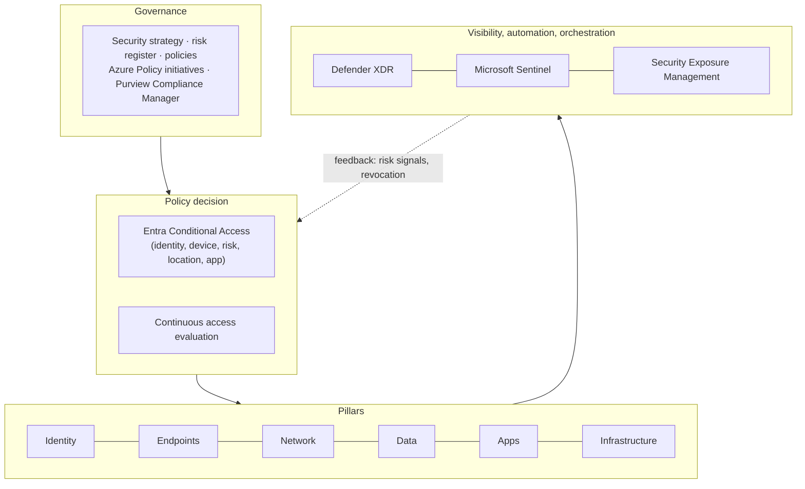
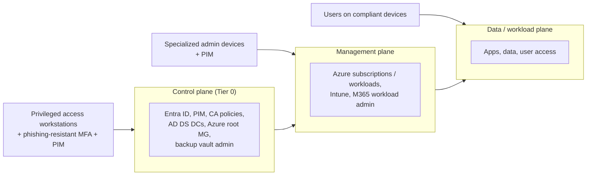
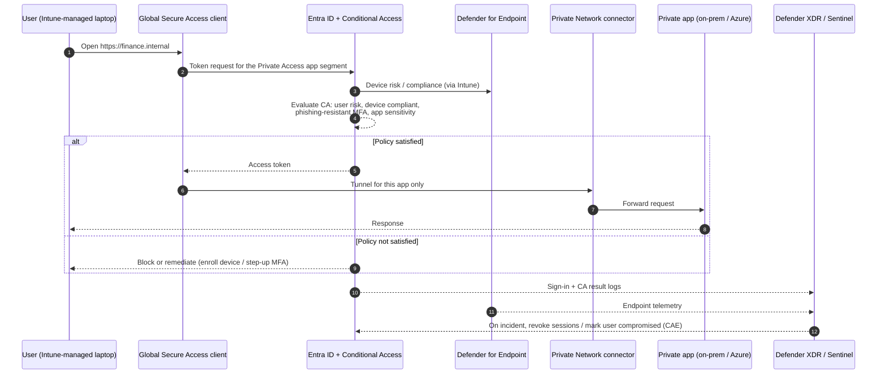

# 02: Architecture Overview

## Logical layers

## Enterprise access model (privileged access)

## Access flow for a user reaching a private app

## Capability map

| Pillar | Primary capabilities | Licensing note (verify current plans) |
|---|---|---|
| Identity | Entra ID, Conditional Access, ID Protection, PIM, ID Governance, Defender for Identity | P1 baseline. P2 / Governance for risk, PIM, access reviews |
| Endpoints | Intune, Defender for Endpoint, Windows LAPS, security baselines | E3 + Defender for Endpoint P2 or E5 Security |
| Network | Entra Private Access / Internet Access, Azure Firewall Premium, DDoS Protection, Private Link, WAF | Global Secure Access licensing is separate |
| Data | Purview Information Protection, DLP, Insider Risk, Audit, Key Vault / Managed HSM | E5 Compliance for advanced features |
| Applications | Entra app registrations, managed identities, Defender for Cloud Apps, API Management, Front Door WAF, GitHub Advanced Security / Defender for Cloud DevOps | Mixed |
| Infrastructure | Azure landing zones, Azure Policy, Defender for Cloud (CSPM + workload plans), Azure Arc, Azure Backup | Consumption-based |
| SecOps | Defender XDR, Microsoft Sentinel, Security Exposure Management, Security Copilot (optional) | Sentinel is consumption-based |
