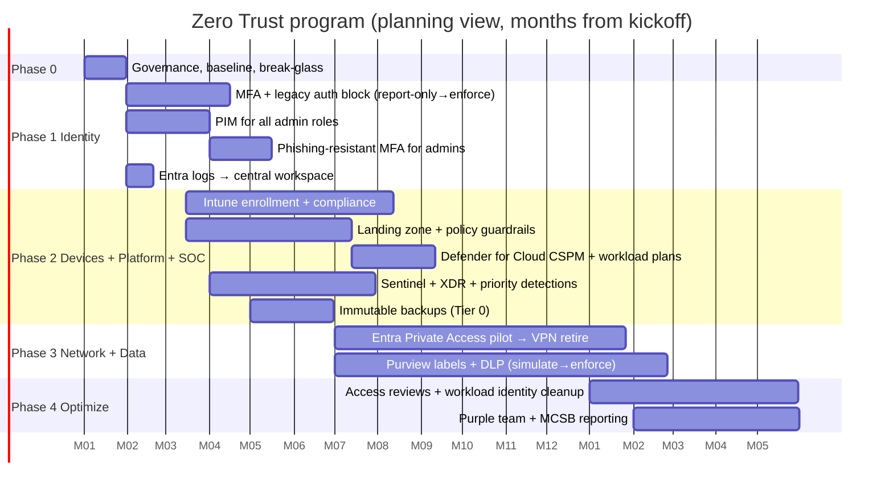
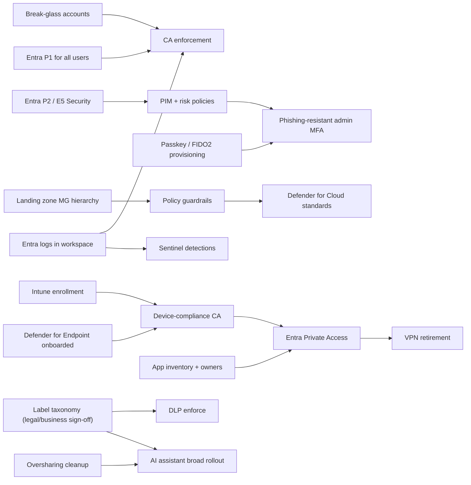

# 04: Phased Rollout Roadmap

An 18-month program for the fictional organization. Durations, targets, and
team sizes are **planning assumptions**, not results.

## Phases at a glance

| Phase | Months | Theme | Exit criteria (all must be true) |
|---|---|---|---|
| 0: Mobilize | 0-1 | Governance, baseline, quick wins | Sponsor and steering group named. Baseline Secure Score / Identity Secure Score recorded. Break-glass accounts created and tested. Risk register approved |
| 1: Protect identities and admins | 1-4 | Stop the most likely and most damaging attacks | CA001-CA005 enforced. Legacy auth blocked (exceptions logged with expiry). All admin roles PIM-eligible. ≤ 5 permanent GAs. Entra logs in central workspace |
| 2: Devices, landing zone, SOC foundation | 3-9 | Make device health and Azure posture visible and enforceable | Intune compliance enforced for M365 (CA100). Landing zone MG hierarchy + core policies live. Defender for Cloud CSPM on all subscriptions. Sentinel + XDR operational with priority detections. Immutable backups for Tier 0 |
| 3: Network and data | 6-14 | Replace VPN, protect data where it lives | Top apps on Entra Private Access, VPN retired for pilot groups. Label taxonomy published, default labeling on. DLP in enforce mode for highest-risk data. Anyone-links disabled |
| 4: Optimize and govern | 12-18 | Make it durable and measurable | Access reviews running on schedule. Workload identity secrets eliminated in Tier 1 apps. Forest consolidation plan approved. Purple-team exercise completed. Controls reported against MCSB quarterly |

## Dependencies

Critical path: **licensing → break-glass/logging → CA enforcement →
device compliance → Private Access → VPN retirement.**

## Risk register

| ID | Risk | Likelihood | Impact | Response | Owner |
|---|---|---|---|---|---|
| R1 | CA or device-compliance enforcement locks out users or executives | M | H | Report-only → pilot rings → enforce. What If testing. Break-glass. Executive pilot early with white-glove support | Identity lead |
| R2 | E5 / P2 / Global Secure Access licensing not funded on time | M | H | Business case per phase tied to findings F1-F8. Phase 1 designed to work on P1 with P2 only for admins | CISO |
| R3 | 9-person team overloaded, BAU suffers | H | M | Sequence pillars, use partner for landing zone build and after-hours SOC, defer Phase 4 items if needed | CISO / PMO |
| R4 | Legacy apps can't support modern auth | H | M | Publish via Private Access/App Proxy, time-boxed exceptions with compensating controls, app modernization backlog | App owners |
| R5 | After-hours SOC gap (business-hours team only) | M | H | Leadership decision: MDR partner vs. on-call rotation (decision point D2) | SOC manager |
| R6 | User resistance to passkeys/device enrollment | M | M | Champions network, comms plan, TAP for onboarding, service desk scripts | Change manager |
| R7 | DLP false positives disrupt client work | M | M | Simulation mode with weekly tuning before enforce. Business-owner sign-off | Data protection lead |
| R8 | Vendor concentration (single-vendor stack) | L | M | Accepted in ADR-0008. Keep log export open (standard formats), review annually | Architect |
| R9 | Acquired forest has unknown trust/privilege paths | M | H | Defender for Identity on both forests early. Exposure Management attack paths. Consolidation in Phase 4 | Identity lead |

## RACI (key deliverables)

R = responsible, A = accountable, C = consulted, I = informed.

| Deliverable | CISO | Security architect | Identity lead | Endpoint team | Network team | SOC manager | GRC | App owners | IT service desk |
|---|---|---|---|---|---|---|---|---|---|
| Program charter, funding | A/R | C | I | I | I | I | C | I | I |
| CA policy set + rollout | A | C | R | C | I | C | I | C | C |
| PIM / privileged access | A | C | R | I | I | C | C | I | I |
| Device compliance | A | C | C | R | I | I | I | I | C |
| Landing zone + guardrails | A | R | C | I | C | I | C | C | I |
| Private Access / VPN retirement | A | C | C | C | R | I | I | C | C |
| Labeling + DLP | A | C | I | C | I | I | R | C | I |
| Sentinel + detections | A | C | C | C | C | R | I | I | I |
| MCSB compliance reporting | A | C | I | I | I | I | R | I | I |

## Measures (targets, not results)

| Measure | Baseline (scenario) | Phase 1 target | Phase 4 target |
|---|---|---|---|
| Users covered by enforced MFA policy | ~70% registered, not enforced | 100% (excluding break-glass) | 100% |
| Permanent Global Administrators | ~40 | ≤ 5 | ≤ 5 |
| Admin sign-ins using phishing-resistant methods | Unknown | 100% for Tier 0 | 100% all admins |
| Legacy auth sign-ins / week | Unknown, measured in Phase 0 | 0 outside approved exceptions | 0 |
| Devices compliant and enforced for M365 | 0% enforced | — | ≥ 95% |
| Subscriptions under landing zone policy | 0 / 14 | — | 14 / 14 |
| Private apps reachable only via Private Access | 0 | — | Top-25 apps |
| Mean time to contain identity incidents | Unknown | Measured | Trending down quarter over quarter |

Baselines marked "unknown" are measured in Phase 0 rather than guessed.

## Leadership decision points

| ID | Decision | Needed by | Options |
|---|---|---|---|
| D1 | Licensing path (E5 vs. E5 Security add-on vs. P2 for admins only) | End of Phase 0 | See R2 |
| D2 | After-hours SOC coverage | Start of Phase 2 | MDR partner / on-call rotation / accept risk |
| D3 | VPN retirement date | Mid Phase 3 | Fixed date vs. per-group as apps migrate |
| D4 | Forest consolidation | Phase 4 | Consolidate / keep with hardened trust |

## Governance cadence

- **Monthly** steering: phase status, risk register, decisions, Secure Score trend.
- **Quarterly**: MCSB control status to audit/GRC, access reviews, tabletop exercise.
- **Change control**: CA, PIM, and Azure Policy changes through pull requests (ADR-0010).
