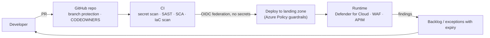

# Pillar: Applications

**Goal:** every app authenticates through Entra ID, SaaS use is visible and
governed, and custom apps are built and shipped through a secure pipeline
without long-lived secrets.

Addresses F8.

## Target state

| Area | Design |
|---|---|
| SSO | All SaaS and custom apps via Entra (OIDC/SAML). Header/Kerberos legacy apps published via Entra Private Access or Application Proxy |
| App governance | User consent limited to verified publishers + low-risk permissions. Admin consent workflow. Defender for Cloud Apps app governance for OAuth app risk |
| Shadow IT | Defender for Cloud Apps discovery (via Defender for Endpoint). Sanction / unsanction. Session controls for risky apps |
| Workload identity | Managed identities for Azure-hosted code. Workload identity federation for GitHub Actions / pipelines. No client secrets in app settings |
| API security | API Management in front of internal APIs: Entra token validation, rate limits, and a WAF in front of the APIM gateway |
| Web ingress | Front Door / Application Gateway WAF with managed rule sets (detection → prevention) |
| DevSecOps | Threat modeling at design. Secret scanning + push protection. Dependency scanning. SAST (CodeQL or equivalent). IaC scanning (checkov/tflint). Defender for Cloud DevOps security connecting GitHub/Azure DevOps posture to the CSPM view |
| Containers | ACR with Defender for Containers scanning. AKS: private cluster, Entra auth + Azure RBAC, workload identity, Azure Policy for Kubernetes |
| AI apps / agents | Approved models only, content filtering, prompt shields, least-privilege agent permissions, human-in-the-loop for high-impact actions (maps to MCSB AI-1…AI-7) |

## Secure delivery pipeline

