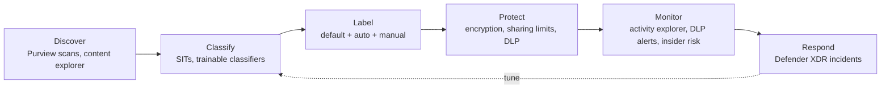

# Pillar: Data

**Goal:** know where sensitive data is, label it, and enforce protection that
travels with the data, whether it sits in M365, Azure, or an AI workload.

Addresses F5. Key ADR: [0006](../adr/0006-purview-sensitivity-labels-default.md).

## Target state

| Area | Design |
|---|---|
| Classification | Purview sensitive info types + trainable classifiers. Label taxonomy: Public / General / Confidential / Highly Confidential (with client-specific sub-labels) |
| Labeling | Default label "General" on new documents and email. Mandatory labeling for Confidential sites. Auto-labeling for regulated data patterns |
| Protection | Encryption on Highly Confidential labels. Label-based site/Teams settings (private, no guests). Container labels |
| Sharing | Disable "anyone" links tenant-wide. Guest access via B2B only. Expiring links for external sharing |
| DLP | Endpoint, Exchange, SharePoint/OneDrive, Teams DLP. Policies in test mode → policy tips → block |
| Insider risk | Purview Insider Risk Management for departing-user data theft scenarios (privacy and HR review required) |
| Azure data | Storage: no shared-key auth, private endpoints, soft delete + versioning. SQL: Entra-only auth, TDE, auditing. Defender for Storage / Databases. Purview Data Map for Azure data estate |
| Keys and secrets | Key Vault (RBAC model, purge protection, private endpoint). Customer-managed keys only where a contract or regulation requires it. Managed HSM for those keys |
| AI workloads | Copilot/AI access respects labels and permissions. Fix oversharing (SharePoint) before Copilot rollout. Purview DSPM for AI. Defender for Cloud AI threat protection for Azure AI workloads |
| Audit | Purview Audit retained per policy. Queried from Defender XDR / Sentinel |

## Data protection lifecycle

## Sequencing rationale

Oversharing cleanup and labeling come **before** broad AI assistant rollout,
because AI assistants surface whatever the user can already reach. DLP starts
in simulation mode to measure false positives before anything blocks.
