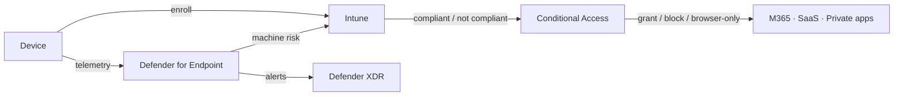

# Pillar: Endpoints

**Goal:** only healthy, managed devices reach sensitive resources, and device
risk is a live input to access decisions.

Addresses F4. Key ADR: [0007](../adr/0007-intune-device-compliance-as-access-signal.md).

## Target state

| Area | Design |
|---|---|
| Management | Intune for Windows, macOS, iOS, Android. Windows Autopilot for new devices. Co-management during transition from on-prem tools |
| Compliance | Compliance policies (OS version, encryption, firewall, Defender for Endpoint risk ≤ medium) feed CA100 |
| EDR / AV | Defender for Endpoint on all clients and servers (Defender for Servers via Defender for Cloud for Azure/Arc servers). Tamper protection on |
| Hardening | Microsoft security baselines via Intune. Attack surface reduction rules (audit → block). Windows LAPS. BitLocker / FileVault |
| BYOD | App protection policies (MAM) for mobile. Browser-only access for unmanaged PCs (CA101) |
| Admin devices | Privileged access workstations for Tier 0, specialized devices for Tier 1 |
| Patching | Windows Autopatch / update rings with deferral by ring. Exposure Management for vulnerability prioritization |
| Mobile / IoT | Corporate mobile under MDM or MAM. Printers and conference devices on isolated networks, excluded from user CA by device filter with compensating controls |

## Device trust flow

## Rollout notes

- Start compliance in "report" mode (CA100 report-only) to measure the
  non-compliant population before enforcing.
- ASR rules go to audit first. Exceptions are reviewed by the endpoint owner.
- Server baselines come from Defender for Cloud / Azure Machine Configuration (see infrastructure).
