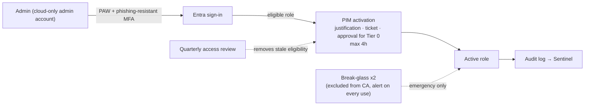

# Pillar: Identity

**Goal:** every human, workload, and agent identity authenticates to Entra ID
with strong, phishing-resistant methods. Access is decided per request by
Conditional Access using risk and device signals, and nobody holds standing
privilege.

Addresses findings F1, F2, and F8. Key ADRs: [0001](../adr/0001-entra-id-single-identity-control-plane.md),
[0002](../adr/0002-phishing-resistant-mfa-for-admins.md), [0003](../adr/0003-pim-just-in-time-admin.md),
[0010](../adr/0010-conditional-access-as-code.md).
Implementation: [05-identity-implementation.md](../05-identity-implementation.md).

## Target state

| Area | Design |
|---|---|
| Identity source | One Entra tenant as the authority. AD DS synced via Entra Connect / Cloud Sync. New apps must use Entra (OIDC/SAML) |
| Authentication | Passkeys/FIDO2 and Windows Hello for Business as the default. Authenticator with number matching as fallback. SMS/voice disabled for admins, then for everyone |
| Conditional Access | Persona-based policy set (below), managed as code, report-only before enforcement |
| Risk | Entra ID Protection user and sign-in risk feed CA. Continuous access evaluation enabled for supported apps |
| Privileged access | PIM for all Entra and Azure privileged roles. 2 break-glass accounts. Separate cloud-only admin accounts. PAWs for Tier 0 |
| Governance | Access reviews for privileged roles (quarterly) and guests (semi-annual). Entitlement management access packages for partners. Joiner/mover/leaver driven from HR |
| Workload identities | Managed identities first. Workload identity federation for CI/CD (no secrets). Certificate credentials where neither is possible |
| External identities | B2B collaboration with cross-tenant access settings. MFA trust only for named partners |
| Agent identities | AI agents get their own Entra Agent ID identities, scoped permissions, and agent-targeted Conditional Access, never a shared human account |

## Conditional Access policy framework

Policies are grouped by persona. Each lists who it targets, what it requires,
and its rollout stage. CA001-CA007 are implemented in the companion Terraform
repo, and the rest are design-only.

| ID | Persona | Policy | Grant / session | Implemented |
|---|---|---|---|---|
| CA001 | All users | Require MFA for all cloud apps | MFA | Terraform (report-only) |
| CA002 | All users | Block legacy authentication | Block | Terraform (report-only) |
| CA003 | Admins (directory roles) | Phishing-resistant MFA, 4h sign-in frequency, no persistent browser | Auth strength | Terraform (report-only) |
| CA004 | All users | MFA for Azure management | MFA | Terraform (report-only) |
| CA005 | All users | Block device code flow | Block | Terraform (report-only) |
| CA006 | All users | Medium/high sign-in risk → MFA, every time | MFA (P2) | Terraform (optional) |
| CA007 | All users | High user risk → MFA + password change | MFA + password change (P2) | Terraform (optional) |
| CA100 | Employees | Require compliant or hybrid-joined device for M365 and Private Access apps | Compliant device | Design only |
| CA101 | Employees, unmanaged devices | Browser-only, no download (app-enforced restrictions / Defender for Cloud Apps session) | Session | Design only |
| CA200 | Guests | MFA, block access to admin portals, limit to approved apps | MFA | Design only |
| CA300 | Workload identities | Block service principal sign-in from outside named locations (Workload ID premium) | Block | Design only |
| CA400 | Agents | Agent-specific CA for Entra Agent ID identities | Per design | Design only |
| CA900 | Security info registration | Register MFA only from trusted location or with Temporary Access Pass | MFA / location | Design only |

**Validation against Zero Trust:** every user persona has an MFA requirement
(verify explicitly). Admins get stronger methods and shorter sessions (least
privilege). Risk-based policies and CAE allow revocation mid-session (assume
breach). Exclusions are limited to the break-glass group and reviewed
quarterly.

## Privileged access

- Target: ≤ 5 permanent Global Administrators **including** the 2 break-glass
  accounts. All other roles eligible-only.
- Tier 0 roles (Global Admin, Privileged Role Admin, CA Admin, Privileged
  Authentication Admin) require approval on activation.
- Protected actions (Conditional Access authentication context) require
  re-authentication for high-impact changes such as CA policy deletion.

## Hybrid identity and AD DS hardening

AD DS stays in place for legacy apps, so it is treated as Tier 0:

- Entra Connect / Cloud Sync servers managed as Tier 0, with no internet browsing and only PAW access
- Microsoft Defender for Identity sensors on all domain controllers
- Windows LAPS for local admin passwords. Remove standing Domain Admin membership
- Disable NTLMv1, enforce LDAP signing/channel binding, and plan Kerberos AES-only
- Remove unconstrained delegation. Audit AdminSDHolder and privileged group changes
- Collapse the two acquired forests over time (roadmap Phase 4)

## Key risks

| Risk | Mitigation |
|---|---|
| CA misconfiguration locks out users | Report-only → pilot ring → enforce. What If testing. Break-glass |
| Passkey rollout stalls (hardware, user friction) | Start with admins (ADR-0002). Use Temporary Access Pass for onboarding |
| Sync server compromise = cloud compromise | Tier 0 treatment, Defender for Identity, minimal sync scope |
