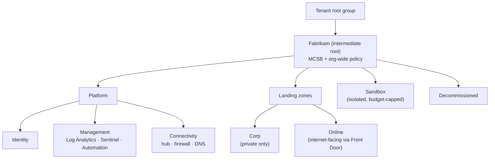

# Pillar: Infrastructure

**Goal:** every Azure (and Arc-connected) resource lands in a governed
structure with baseline policies, continuous posture assessment, workload
protection, and recoverable backups.

Addresses F6 and F7. Key ADRs: [0005](../adr/0005-azure-landing-zones-policy-as-guardrails.md),
[0009](../adr/0009-immutable-backups-separate-admin-plane.md).

## Target state

| Area | Design |
|---|---|
| Structure | Azure landing zones management group hierarchy: Platform (Identity, Management, Connectivity) and Landing Zones (Corp, Online), plus Sandbox and Decommissioned |
| Guardrails | Azure Policy initiatives assigned at management groups: allowed regions, deny public IPs on NICs in Corp, require private endpoints, diagnostic settings to central workspace, required tags, MCSB initiative in Defender for Cloud |
| Posture | Defender for Cloud with Defender CSPM. MCSB as the default standard plus regulatory standards relevant to clients. Secure Score reviewed monthly by owners |
| Exposure | Microsoft Security Exposure Management attack paths and critical asset tagging to prioritize fixes |
| Workload protection | Defender for Servers (Plan 2 for internet-facing / Tier 0), Storage, Databases, Key Vault, Containers, App Service, Resource Manager |
| Hybrid / multicloud | Azure Arc for on-prem servers (policy, Defender for Servers, update management). AWS/GCP connectors in Defender for Cloud if adopted |
| Compute hardening | Trusted launch / secure boot / vTPM. Azure Bastion + JIT for VM admin (no public RDP/SSH). Encryption at host. Azure Machine Configuration baselines |
| Backup / BCDR | Azure Backup with immutable vaults, soft delete, multi-user authorization (Resource Guard in a separate subscription/tenant admin scope). Quarterly restore tests |
| Resource locks | CanNotDelete locks on platform resources (hub, Log Analytics, Key Vaults) |

## Management group hierarchy

## Ransomware resilience

| Control | Design choice |
|---|---|
| Separate admin plane for backup | Backup operators use different identities. Resource Guard owned by a different team, so deleting backups needs a second person |
| Immutability | Immutable vault (locked after validation), soft delete enabled and always-on |
| Restore testing | Quarterly restore of Tier 0 and top-10 business apps, with evidence kept for audit |
| Detection | Defender XDR attack disruption. Alerts on mass deletion and backup policy changes |
