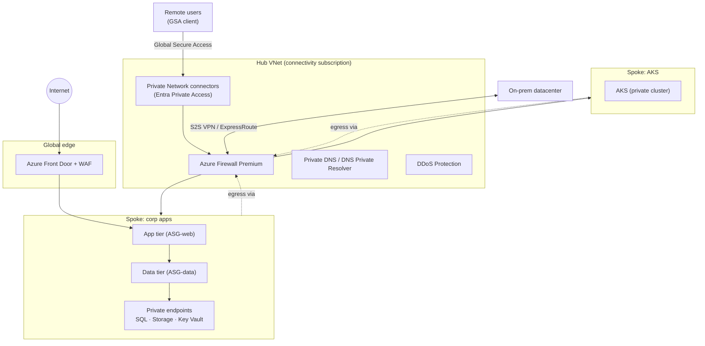

# Pillar: Network

**Goal:** replace implicit network trust with per-app, identity-aware access,
segment Azure workloads, and inspect what crosses boundaries.

Addresses F3. Key ADRs: [0004](../adr/0004-entra-private-access-replaces-vpn.md),
[0005](../adr/0005-azure-landing-zones-policy-as-guardrails.md).

## Target state

| Area | Design |
|---|---|
| User → private apps | Microsoft Entra Private Access (Global Secure Access) with per-app segments and CA. Client VPN retired after migration |
| User → internet / M365 | Entra Internet Access for web filtering and M365 traffic profile with tenant restrictions |
| Azure topology | Hub-and-spoke from Azure landing zones. Azure Firewall Premium in the hub (TLS inspection, IDPS for selected flows). Spokes peered only to hub |
| PaaS access | Private endpoints for Storage, SQL, Key Vault. Public network access disabled by Azure Policy |
| Ingress | Azure Front Door with WAF (or Application Gateway WAF for regional apps). DDoS Protection on public IPs in the hub |
| Segmentation | NSGs + ASGs per spoke tier. Deny-by-default between spokes. Azure Virtual Network Manager for org-wide security admin rules |
| DNS | Azure Private DNS zones in the hub. DNS Private Resolver for hybrid |
| Logging | VNet flow logs, Azure Firewall logs, and WAF logs to Sentinel |

## Azure network design

## Migration from VPN

1. Discover app usage with Quick Access (broad segment) in parallel with VPN.
2. Define per-app segments for the top apps by usage. Apply CA per segment.
3. Move pilot groups off VPN, then remove VPN entitlement by group.
4. Decommission VPN concentrators. Keep a break-glass remote access path documented.
