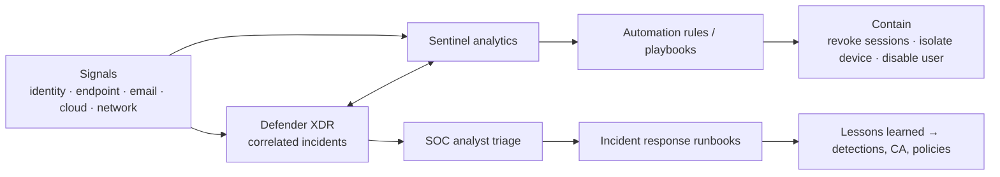

# Cross-cutting: Security Operations (visibility, automation, orchestration)

**Goal:** a small SOC can detect, investigate, and contain incidents across
identity, endpoint, email, cloud apps, and Azure from one place, with
automation doing the repetitive containment.

Key ADR: [0008](../adr/0008-defender-xdr-plus-sentinel.md).

## Target state

| Area | Design |
|---|---|
| XDR | Defender XDR correlating Defender for Endpoint, Office 365, Identity, Cloud Apps, and Entra ID Protection. Automatic attack disruption enabled |
| SIEM | Microsoft Sentinel on the central Log Analytics workspace, operated from the Defender portal (unified SecOps) |
| Data sources | Entra sign-in/audit/risk logs, Azure Activity, Defender for Cloud alerts, Azure Firewall/WAF/flow logs, Purview Audit, on-prem syslog/CEF via AMA, Windows Security events via DCR |
| Detection engineering | Content hub solutions + custom analytics rules. Coverage tracked against MITRE ATT&CK. Detections in source control |
| SOAR | Automation rules + Logic Apps playbooks: revoke sessions, disable user, isolate device, open ticket, notify on-call |
| Coverage model | Business-hours internal SOC + managed detection and response partner after hours (decision for leadership, see roadmap risk R5) |
| Retention | Interactive retention per data type. Long-term retention tier for investigations and audit |
| Exercises | Quarterly tabletop (ransomware, compromised admin, BEC) and purple-team testing of top detections |

## Detection-to-response flow

## Priority detections (initial set)

| Scenario | ATT&CK reference | Data source |
|---|---|---|
| Break-glass account sign-in | T1078.004 | SigninLogs |
| CA policy or exclusion change | T1556 | AuditLogs |
| PIM activation outside working pattern | T1078.004 | AuditLogs |
| Impossible travel / anonymous IP with success | T1078 | ID Protection, SigninLogs |
| OAuth app granted high-privilege permissions | T1528 | AuditLogs, app governance |
| Mass file download / deletion | T1530, T1485 | Purview Audit, Defender for Cloud Apps |
| Backup policy or vault change | T1490 | Azure Activity |
